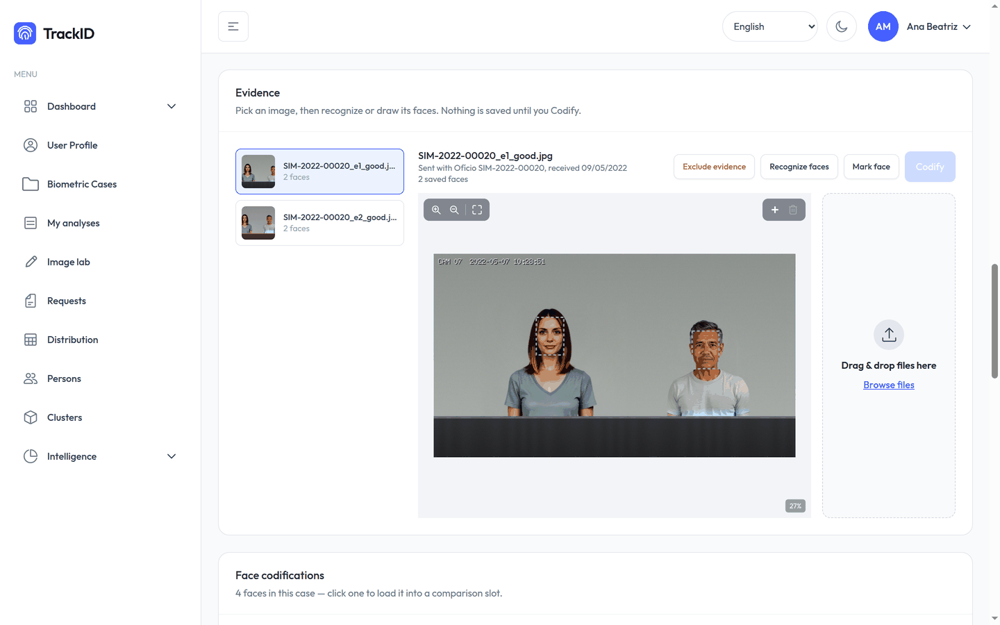
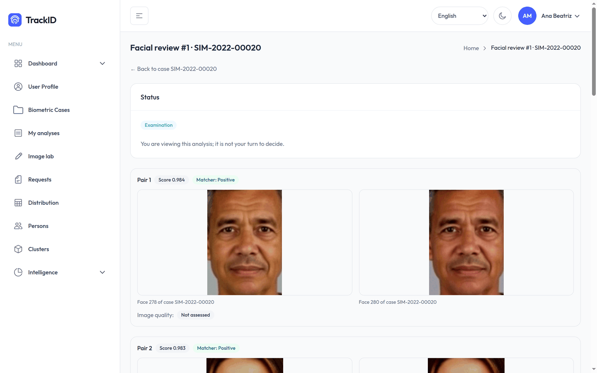
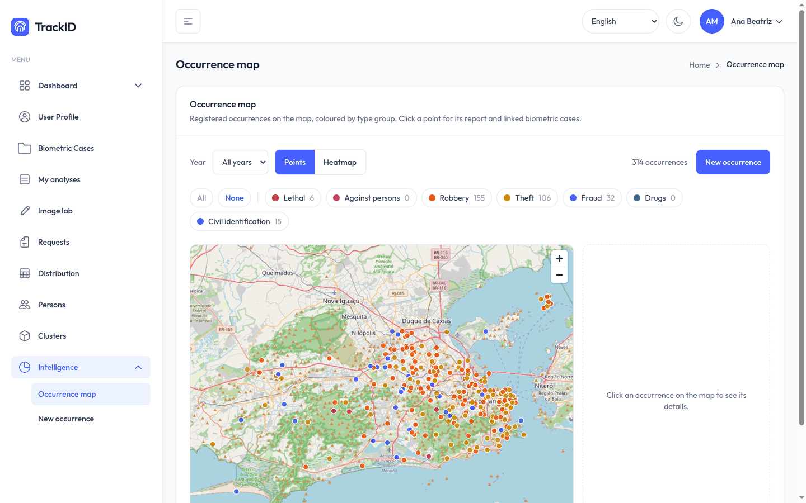
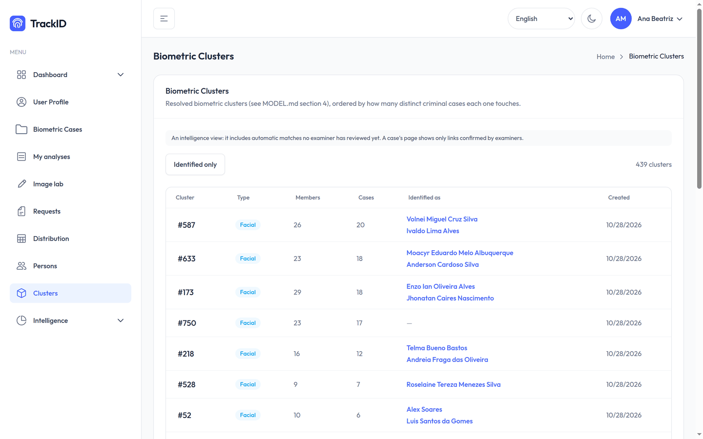
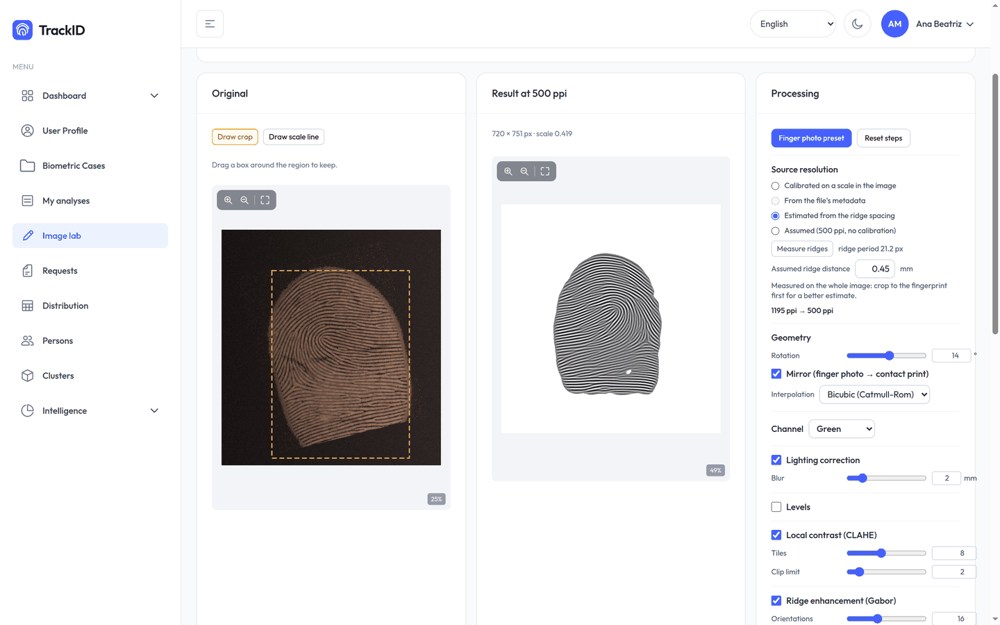
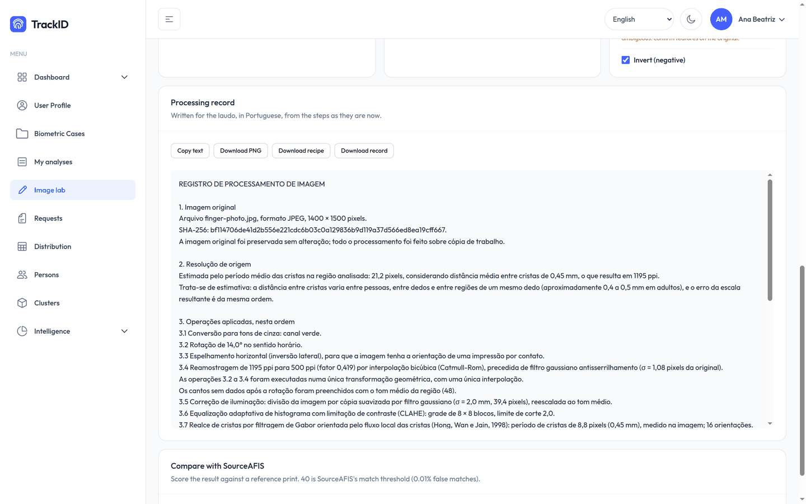

# TrackID

**Forensic biometric case management, from the authority's request to the expert report.**

TrackID is an open-source platform for forensic institutes that examine faces and fingerprints.
It does the following:

- registers what an authority asks and the material it sends;
- organises that material into cases;
- runs automatic matching and clustering;
- takes examiners through reviews and comparisons, verified independently;
- drafts the report (*laudo*) they edit and issue.

The interface is in English and Brazilian Portuguese; the reports are in Portuguese.

> **Status: research prototype.** Every image and record used in development and in the
> screenshots is synthetic, generated by a companion simulator. The matching thresholds are
> defaults, not validated on operational data: an institute must validate them before any
> casework use.

| | |
|---|---|
|  |  |
| Case evidence, each file with the request that sent it | Facial review of a trace against its candidates |
|  |  |
| Occurrences on a map, for analysts | Clusters linking traces to identified persons |
|  |  |
| Image lab for fingerprints | Its processing record, for the laudo |

## What it does

- **Requests first.** Register the authority's request (*ofício*) with its questions. The
  request finds or creates the occurrence it cites and opens one case per exam asked. The
  material sent in is kept with its SHA-256.
- **Faces and fingerprints.** Evidence images and video, traces marked by hand or detected
  automatically, and codifications. Face detection and embedding run on the server (YuNet,
  AuraFace). Fingerprint templates and matching come from SourceAFIS.
- **Matching and clustering.** The system proposes links, and examiners decide them in rounds:
  verification (blind), review, and a third examiner when two disagree. Questioned material is
  grouped into clusters linked to identified persons.
- **Facial examination following FISWG.** A one-to-many review produces a lead report. A
  one-to-one comparison records each trace's suitability and concludes on a seven-level scale
  in a laudo.
- **Reports.** The draft is a .docx built from the case's locked data. Examiners edit it in the
  browser ([WordCraft](https://github.com/storytold/wordcraft)), and issuing renders the PDF and
  keeps both files with their SHA-256.
- **Image lab for fingerprints.**
  - Levels, inversion, colour channel, lighting correction, CLAHE and Gabor ridge enhancement.
  - Finger photos converted to the orientation and resolution of a contact print.
  - Output at 500 ppi from a reproducible recipe.
  - A processing record written for the laudo.
- **Video.** Face tracks from video sent in, and frames taken as evidence with their time.
- **Intelligence.** Occurrences on a map, persons and clusters, for analysts.
- **Access profiles.** Examiner, coordinator, intelligence analyst and admin, each limited to
  their own work.

Built with Go (Gin, sqlc, Asynq), PostgreSQL with pgvector and PostGIS, MinIO, and React 19 with
Vite and Tailwind CSS. The models run locally (ONNX Runtime, SourceAFIS); nothing is sent to an
outside service.

## Try it

```sh
scripts/start_dev.sh   # starts the stack, migrates, and runs the API and the frontend
```

There is no public sign-up: create the first account with `cmd/create-superuser`. Report editing
needs [WordCraft](https://github.com/storytold/wordcraft) built beside this repo, and video needs
`ffmpeg`; [docs/ARCHITECTURE.md](docs/ARCHITECTURE.md#development) has the details.

## Documentation

- [Architecture](docs/ARCHITECTURE.md): the reusable core, data flow, structure, extension
  contract and development setup.
- [Models and licences](docs/MODELS.md): the models TrackID runs, where their weights come from,
  and the licences of each, including the map tiles.
- Plans, each with what is decided and what is built:
  [facial reports](docs/facial-reports-plan.md),
  [access profiles](docs/access-profiles-plan.md),
  [reviewed clusters](docs/reviewed-clusters-plan.md),
  [request routing](docs/request-routing-plan.md),
  [fingerprint image processing](docs/fingerprint-image-processing-plan.md).

## Licence

Apache-2.0 (see [LICENSE](LICENSE)); cite it with [CITATION.cff](CITATION.cff). The frontend
is based on TailAdmin React, MIT, whose notice is kept in [frontend/LICENSE.md](frontend/LICENSE.md).
The model weights are not covered by this licence and are not bundled: see [docs/MODELS.md](docs/MODELS.md).

## Authorship

TrackID is written by Rodrigo Fileto Cuerci Maciel, with the help of AI coding assistants:
[Claude Code](https://claude.com/claude-code) (Anthropic) and DeepSeek. The assistants write
code, tests and documentation under the author's supervision; the author directs the work,
reviews it and is responsible for the result. Commits made with Claude Code end with a
statement of what in them was done with it.
